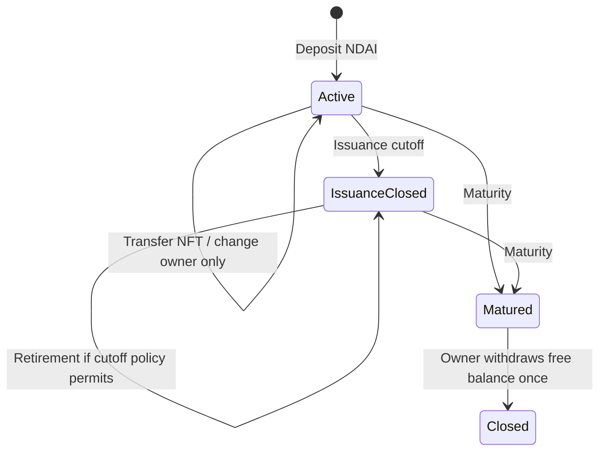
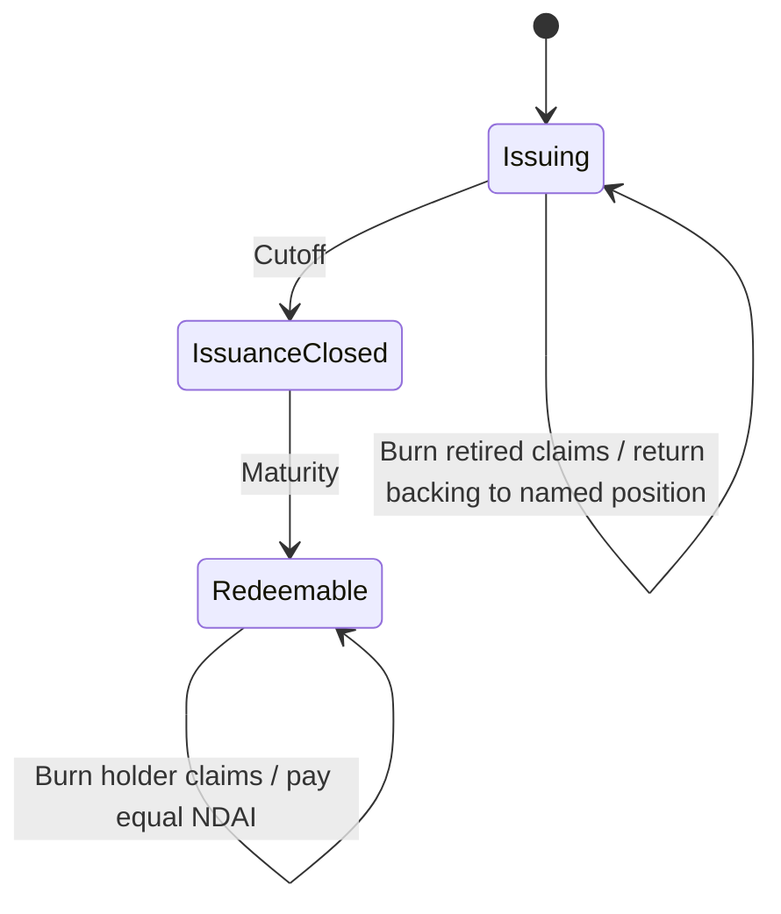

# NDAI accounting amendment

**Status:** For design review. The same-series retirement rule below is confirmed. Proposed accumulator and activation mechanics require approval and testing. This document contains acceptance tests for the revised design.

## Decision reconciliation

| Topic | Recorded decision or remaining approval |
|---|---|
| Model | Direct NDAI collateral and date-specific fee vaults follow the principles discussed by Johnny Chaos and Crispy. HEX economics, T-shares, emissions, Cities rules and external staking code are outside the design. |
| Maturity | One shared series, redeemable 90 days after launch. If launch stays December 25, 2026 at 08:00 UTC, issuance and new claim-issuing stakes close March 24, 2027 at 08:00 UTC and redemption opens March 25 at 08:00 UTC. Confirm the final launch timestamp and whether fee-vault deposits close at the issuance cutoff. The 90-day fee-vault withdrawal clock is separate. |
| Weight | **Final and approved.** Sum activated, unwithdrawn NDAI deposit tranches in the matching fee vault. All principal in claim-issuing positions, free or encumbered, contributes zero. A fee payer can participate through an already eligible fee-vault deposit. |
| Activation | **Confirmed.** Each tranche activates at its deposit block timestamp + 86,400 seconds. Process activations as part of ordinary calls. Epoch rounding is excluded from this design. |
| Zero weight and allocation | Previously approved rule waives the issuance fee when eligible weight is zero, so there are no fees from that issuance to carry forward. Otherwise, all of the 1% gross issuance fee goes to the same-date fee vault for pro-rata allocation. Unsolicited transfers do not become fee revenue. Confirm who can receive residual dust after the series closes. |
| Exit and burn | Previously approved fee-vault penalty starts at 5%, declines linearly to zero over 90 days from the latest deposit or top-up, rounds down, and is burned. The mint's separate 20% pDAI budget funds permanently locked pDAI/PLSX liquidity. A separate mint-time burn needs explicit approval, including percentage, route and destinations. Claim-position early exit is still open. |
| Ownership and expiration | Previously approved stake NFT transfers carry residual principal rights and debt. Fee deposits and accrued fee rewards remain with the depositor. Time tokens transfer independently. Matured principal and funded claims remain claimable indefinitely. Operator powers and protection against stale transfer terms remain open. |
| Retirement | **Confirmed.** Owners may burn any same-series claims they hold before maturity, including claimed fee rewards, against their own outstanding position debt. Confirm the retirement cutoff relative to the issuance cutoff. Proposed default allows retirement until maturity. |

## Position and series state diagrams

Fee-vault lifecycle runs independently: deposit → pending tranche → eligible tranche → partial or full withdrawal. Top-ups reset the withdrawal clock without resetting older eligibility. Withdraw pending amounts newest first, then eligible amounts. Debiting an eligible balance first checkpoints earned fees. Confirmed reward entitlements remain claimable after a full withdrawal or an NFT transfer.

## Collateral ledger and retirement

Record free principal and attributed debt per position. Track reserved NDAI and outstanding token supply per series, using matching claim/NDAI base units. Keep fee-vault principal physically isolated from claim collateral and permanent DAI. Keep custody of collected fee tokens and their reward entitlements separate. Series backing compartments and deterministic debits must be finalized under D07/D13. Fungible claims convey same-series redemption rights irrespective of original issuance or fee provenance.

Before maturity, the authenticated position owner submits a positive amount X of the canonical same-series token with X ≤ that position's debt. Burn from the owner's authorized balance, decrease position debt, encumbrance and series claim reserve by X, and credit X to that position's free ledger. Any custody movement returns backing from claim escrow to free-principal custody. No NDAI goes to the wallet through retirement. A failed burn, balance check or custody transfer reverts the whole operation. A third party must first transfer tokens to the owner unless a separately approved authorization path exists.

At maturity, fix each position's debt as the exclusion from its principal payout. Holder redemption burns X and pays X from series escrow. It decreases series supply and backing but leaves that position's exclusion intact. The original position may close before or after holder redemption. Position attribution is counted only before maturity when reconciling aggregate debt against series supply. It is an exclusion record thereafter, so holder redemptions cannot create a second position payout.

## Reward index and activation

**Candidate index.** Each redemption date has its own index I with provisional scale Q = 10^27. Each fee-vault account checkpoints its settled eligible balance W against index J, with whole-unit claimable C and fractional remainder r. At index I, set C := C + floor((W × (I − J) + r) / Q), r := (W × (I − J) + r) mod Q, and J := I. Use full-precision quotient/remainder operations. An activated but untallied tranche of amount w adds w × (I − I_A) in scaled entitlement, where I_A is the index recorded at activation. Fold it into W exactly once after settling existing W. Before withdrawals settle entitlement and debit pending tranches newest first, then eligible principal. Pull claims debit C before transfer. NFT ownership changes neither fee-vault weight nor checkpoints.

For gross issuance G, if E (total eligible weight) is zero, send G claims to the issuer and collect 0. If E is positive, F = ceil(G / 100), reserve G, allocate G − F to the issuer and escrow F. Reject zero net. Credit fees only on confirmed receipt through the issuance path. Fee claims earned are ultimately paid by transfers from that inventory. Reward claims debit accrued balances first and do not mint claim tokens.

For F actually collected, proposed increment is floor((F × Q + R) / E), where R is the previously undistributed **scaled** global remainder. Next R is the remainder of the same division. The recommended conservative policy carries R into later fee distributions while the eligible cohort and weights are unchanged. On a weight change, quarantine R for the same series until a terminal rule is approved. Never count a user's fractional entitlement as global dust. Neither weight changes nor zero-fee events distribute new rewards. Explicitly approve any policy that would let new entrants receive residuals earned before their activation.

**Confirmed activation and event order.** For deposit block timestamp d, activation A = d + 86,400. At t, process every A ≤ t before any fee allocation or weight-changing action. Save I_A before crediting that timestamp’s first fee. A fee at A counts, a fee at A−1 does not. Several fees in the same block follow transaction order, and the activation batch runs only once. Derive d exclusively from chain time, including for top-ups. Never accept caller-supplied deposit or activation times. A withdrawal at A treats the tranche as eligible and checkpoints before decreasing weight.

**Proposed bounded scheduling.** Maintain an ordered series queue of distinct activation timestamps and aggregate pending amounts. Checkpoint the index per due timestamp, add its scheduled weight once and cancel pending amounts on withdrawal. Same-second deposits share one queue key. Set a hard cap K on outstanding live timestamp keys and P on unprocessed tranches per fee account. Coalesce same-second tranches. Before creating a new queue key, first settle all due keys, then reject new deposits exceeding either cap. Withdrawals, claims and issuance automatically process all due series keys within K and all relevant account entries within P. They require no standalone activation or keeper. Delete or compact canceled keys and settled tranches, with no tombstone scans. A permissionless sync may be optional. Measure worst-case cold-storage gas for both bounds together before approval. Caps create deposit-capacity denial-of-service risk. Reject that configuration if adversarial capacity tests show persistent enrollment blocking or if any exit cannot finish within the block gas budget.

Conservation checks per series: cumulative claimed fees plus all current payable entitlements, outstanding fractions and reserved undistributed dust are bounded by cumulative actual fee receipts, compared at the same scale. Before maturity, series reserved NDAI equals outstanding claims and summed live position debt in the proposed exact-funding model. After maturity series reserved NDAI continues to equal outstanding claims, while position exclusions no longer enter that equation. Each live position's attributed debt equals its encumbrance before maturity. Permanent DAI is outside every settlement path.

## Numerical examples

All amounts below are in a common unit for readability. For the activation example use deposits A = 1,000 at t=0, B = 3,000 at t=3,600, and a top-up C = 1,000 into A's account at t=7,200. Their activation timestamps are 86,400, 90,000 and 93,600. Each event requests 10,000 gross claims.

| Fee time (seconds) | Eligible balance | Fee collected | Reward to A's original tranche / B / top-up C |
|---:|---:|---:|---:|
| 86,399 | 0 | 0 | 0 / 0 / 0 |
| 86,400 | 1,000 | 100 | 100 / 0 / 0 |
| 89,999 | 1,000 | 100 | 100 / 0 / 0 |
| 90,000 | 4,000 | 100 | 25 / 75 / 0 |
| 93,600 | 5,000 | 100 | 20 / 60 / 20 |

A's account earns 265 total and B earns 135. Aggregate rewards equal the 400 fee claims collected. Redeeming or retiring a distributed fee claim changes the corresponding series liability exactly once.

## Weight comparison and engineering risks

| Candidate | Weight at a fee event | Tradeoff |
|---|---|---|
| Eligible principal, approved | Current activated fee-vault NDAI | Direct pro rata allocation. Long-lived large balances can dominate. The 24-hour wait excludes same-transaction deposits. A whale with advance notice can still qualify before a large issuance and withdraw afterward under the existing penalty. |
| Time-weighted eligible balance | Integral of eligible balance over a defined historical interval | Reduces the effect of weight added just before fees. Requires a lookback, bounded checkpoints and rules for exited positions. Define the integral using only time at or after each tranche's activation. |
| Duration-weighted eligible balance | Eligible principal × approved duration factor | Needs a separate duration policy. A common factor cancels in pro-rata allocation. A factor based on the resettable withdrawal clock would give a top-up an immediate boost on older principal and is unsuitable without separate controls. |

Eligible principal is final. Concentration and timing tests assess launch risk. Deposits in the claim collateral vault confer zero reward weight. Simulate a 99% eligible depositor, announced issuance and exit immediately after allocation. Quantify fee share and exit cost independently. Wallet-local caps cannot prevent concentration across multiple wallets.

**Accounting attack paths.** A stale total can waive a fee after eligible weight has appeared. A tranche using the current or deposit-time checkpoint in place of its recorded activation index can lose fees or capture earlier fees. A checkpoint applied twice can duplicate activations or payouts. Carrying old cohort dust into a changed cohort can give new entrants earlier fees. Snapshot all due activations first, bind each tranche to its own pre-fee checkpoint, consume entries once, debit claims before transfer, and separate dust by cohort. For collateral, a maturity redemption that credits the NFT's free balance would pay the same NDAI twice. Freeze the position exclusion separately from remaining series supply. Keep issuance, retirement and redemption mutually exclusive where required by the timestamp. Reserve DAI must never enter any of these ledgers or transfer paths.

**Arithmetic acceptance.** Select caps so the worst-case lifetime index bound `floor(totalLifetimeFees × Q / minimumPositiveEligibleWeight)` fits the chosen storage type. Include all carried dust in the lifetime revenue audit without counting it as additional revenue. Test checked index addition, quotient and remainder at maximum products, remainder addition near type limits, balances greater than Q where small fees may produce zero index increments, and a weight change with both global dust and per-account fractions. Use base units in the reference model. Pending reward liabilities include entitlements of activated tranches even before their account has checkpointed.

## Additional accounting examples

- **Fee and distribution.** A position with 12,000 free NDAI issues 10,000 claims. With eligible deposits of 1,000 and 3,000 NDAI, 9,900 claims go to the issuer and 100 to fee escrow. Depositors accrue 25 and 75 claims. Series backing rises by 10,000 NDAI and the position has 2,000 free. With zero eligible weight, the issuer receives all 10,000 claims and backing is still 10,000.
- **Retirement using rewards.** The owner acquires 1,000 matching claims, including 25 claimed fee tokens. Retiring all 1,000 leaves 9,000 position debt, 9,000 series claims and 9,000 NDAI in claim reserve in this single-position example. The position has 3,000 free NDAI. The retirement pays zero NDAI to the wallet.
- **No double release.** At maturity, holders redeem the remaining 9,000 claims for 9,000 NDAI. The NFT owner can withdraw 3,000 NDAI whether that withdrawal happens first or last. The total payout is 12,000 NDAI.
- **Rounding.** In an illustrative Q = 10 index with three equal one-unit weights, a one-unit fee increments the index by 3 and leaves one scaled unit of global dust. Three such fees produce index increments 3, 3 and 4. Each holder then has one claim unit. The production candidate uses Q = 10^27.

## Acceptance tests

| Test | Expected result |
|---|---|
| Gross issuance with and without eligible weight, including fractional; attempt over-issuance | Exact gross backing; correct net and escrow deltas; zero fee/no backlog at zero weight; over-issuance reverts atomically. |
| Retirement with purchased, transferred and claimed fee tokens | Supply, named position debt and encumbrance decrease equally; free balance increases equally; wallet principal and all other positions remain unchanged. |
| Wrong owner, wrong series, insufficient balance, zero, debt overpayment, repeat burn, failed custody movement | Operation reverts and all state and balances stay unchanged. |
| Redemption and withdrawal in both orders; partial and repeated redemption | Each successful burn pays the exact funded amount; no early redemption, double redemption or second release to the NFT owner. |
| Fee claim double pull, direct donations, zero fees and independent series | Repeat pull cannot duplicate payment; only authenticated receipts increase rewards; no cross-series claims or collateral movement. |
| Micro-fees, one-base-unit and extreme approved balances, partial withdrawals and cohort changes | Compare against an independent integer reference. No overflow, unbacked reward, dust duplication or rounding-based double claim. |
| Fee receipt at activation −1 second, exactly at activation and +1 second; multiple issues and exits at the exact boundary | Only eligible tranches earn. Activate before fee pricing and weight mutations, then apply transaction order. Timestamp input and replay cannot backdate or duplicate eligibility. |
| Top-up and newest-first pending withdrawal, including exact activation boundary | Old weight keeps eligibility, pending weight is canceled correctly, and the latest addition resets the withdrawal lock. |
| Ownership transfer before and after fee receipt, early exit at start/midpoint/expiry, issuance cutoff and maturity ±1 second | Principal rights and debt follow NFT; fee deposits/claims remain with depositor; burn never exceeds 5%; boundary rules hold. |
| Saturated activation queue, account tranche cap, canceled keys and long inactivity | Ordinary calls process due work within approved bounds. Capacity exhaustion can reject new deposits, while withdrawals and claims remain callable. Validate gas at simultaneous K and P maxima. |
| Stateful fuzz with two or more positions and series | Check all seven amendment invariants after each successful or reverted action. Verify the permanent DAI reserve remains isolated throughout. |

## Approvals required before implementation

### Reference validation

- The local suite passed 15 tests, including 256 fuzz cases on scaled fee conservation and deterministic uint256 overflow boundaries. The existing staking prototype passed transferred-position retirement and maturity settlement in both payout orders using a test token. The prototype does not issue fee rewards, so retirement using fee-derived claims still needs an integrated test.
- The queue fixture confirmed that a competing depositor could claim eight freed distinct-timestamp slots in succession, blocking a later distinct-timestamp deposit each time. The rejected attempts charged nothing, and the waiting depositor entered after activation drained the queue. First-come admission does not guarantee access under sustained competition. Keep 32/8 provisional and compare it with append-only timestamp scheduling and bounded permissionless catch-up before fixing limits.

- The expanded test-only fixture moved gross claim backing into a separate custody address and reconciled fee inventory after a successful claim and a zero-value repeat claim. At 32 overdue timestamps and eight caller tranches, issuance used 826,593 gas (1.84% of pinned block gas). Withdrawal with a burn used 676,922 (1.50%) and issuance with a maximum partial shift used 512,036 (1.14%). Eight consecutive saturation and recovery cycles passed, including fractional fee round-up. All nine activation tests passed. These are call measurements before transaction overhead. Claim collateral funding is simplified and redemption, NFT attribution and full-range arithmetic are outside this fixture.
- Treat 16,777,216 gas as a conservative comparison budget only. Issuance used 4.93% of that budget. Go-Pulse ties its separate transaction cap to Osaka activation. Confirm the active rules and node transaction policy for the intended release environment before finalizing limits. The simulation validates recovery after slots become available. It does not establish fair access when competing deposits continually refill them. [Go-Pulse transaction validation](https://gitlab.com/pulsechaincom/go-pulse/-/raw/master/core/state_transition.go)

- A cold issuance at the oldest activation timestamp shifted the maximum 31 remaining series keys and seven remaining caller tranches. It used 470,595 gas, including the fixture's token operations. A three-cycle saturation test verified full-queue rejection, cancellation, refill and subsequent activation without duplicated eligible weight. All nine local activation tests passed.
- The supplied RPC readings from rpc.pulsechain.com and rpc-pulsechain.g4mm4.io agree on chain ID 369 and block 28055880, hash `0x8ba00c1c1d5de3a22f6f3ff897c2939ef08b04bc35c114ddcbd47ca4ad60de85`, gas limit 45,000,000. The simplified issuance, withdrawal and maximum partial-shift measurements use 1.74%, 1.50% and 1.05% of that historical block limit, respectively. The chain 369 guard still needs implementation and negative-chain tests.

- A separate test-only flow fixture processed 32 due timestamps and 8 caller tranches. The local gross call measurements were 785,152 gas for issuance with test ERC-20 transfers and fee minting, and 676,922 gas for withdrawal with a supply burn. All four flow tests passed, including same-second coalescing, the exact activation boundary, cancellation, and saturation recovery. These measurements use a different storage layout and simplified claim funding, so use them alongside the isolated figures. The fixture omits the complete position and reward settlement paths.
- The 32/8 limits remain provisional. Benchmark the complete accounting paths with segregated collateral, entitlement settlement and exact rounding. Verify transaction gas limits for the intended PulseChain fork as well as block gas headroom, and test sustained competition for deposit slots before fixing capacity.

- BigInt checks passed for 10,000 repeated one-unit fees, intermittent claims and weight changes, with exact scaled conservation after every distribution and claim. Zero weight collected zero.
- Another 12 assertions passed for exact activation boundaries, pre-maturity retirement, both maturity payout orders, rounding and uint256 edge cases. These checks exercise the mathematical model. The full acceptance matrix still needs contract execution.
- At minimum positive weight of one base unit, the worst-case lifetime fee bound for a uint256 index is floor((2^256 − 1) / 10^27) base units. The unscaled intermediate F × Q exceeds uint256 for sufficiently large inputs. Use wide multiplication and quotient/remainder arithmetic for both global and account checkpoints. Account for a remainder addition that crosses the denominator without blindly adding two uint256 values.
- At eligible weight 2^256 − 1, a one-base-unit fee advances the index by zero. Its entire scaled value becomes undistributed dust. This is a material distribution limitation at extreme weight. Approve realistic principal and revenue caps and an acceptable dust bound before selecting the scale.
- A large depositor can qualify 24 hours ahead of a predictable issuance, collect a disproportionate share, and exit afterward. Amount caps per wallet can be bypassed across wallets. A funded series may also face queue saturation from distinct-timestamp deposits. The proposed cap protects settlement at the expense of accepting more deposits.
- **Initial gas benchmark.** All three isolated Forge fixtures passed with cold storage after 90 days of simulated inactivity. Measured gross call gas was 1,180,121 for 32 due keys and 8 tranches, 2,266,298 for 64 keys and 16 tranches, and 4,438,649 for 128 keys and 32 tranches. The measurement excludes fixture deployment and external token operations. Start integrated testing at K=32 and P=8 as provisional settings. Before approving limits, benchmark full issuance and withdrawal, cancellation, same-timestamp coalescing, repeated saturation and recovery, and gas headroom against a verified PulseChain fork block limit. Whenever required settlement cannot complete, revert the entire operation before allocating or waiving fees or moving collateral.

- Approve queue and tranche bounds after adversarial gas and enrollment-capacity testing. Exact 86,400-second activation and automatic settlement are confirmed.
- Approve Q after extreme-value testing, bound arithmetic and queue inputs, and settle fractional entitlement, global dust and terminal custody.
- Confirm the final launch timestamp, fee-vault enrollment cutoff, retirement cutoff, free-principal early exit, sizing caps and asset compartment rules.
- Confirm the existing reward-weight and zero-weight decisions if the amendment was intended to change them. Confirm remaining operator, mint and external dependency details in the main register. Independent audit and remediation precede real funds.

### Permissionless activation catch-up validation

The fixed-cap fixture can reject deposits when its 32 distinct pending timestamps are full. The test-only alternative appends ordered timestamps and processes at most 32 due keys per permissionless sync. Issuance reverts before assigning fees whenever any due key remains. After a long gap with 35 due keys, two sync transactions allowed issuance to resume. The 32-key batch measured 512,392 gas inside the fixture. This is a local execution measurement and excludes transaction overhead and any production integration.

A second integration test allocated an actual issuance fee claim, paid it to the buyer of a transferred position, burned it against that position's same-series debt, and verified that exactly one NDAI became unencumbered. At maturity, 99 NDAI settled remaining claims and 1 NDAI went to the position owner. The fee deposit remained intact.

All 17 targeted local tests passed. Both queue limits remain provisional. The append-only fixture has growing historical storage, and bounded catch-up controls work per transaction while leaving total backlog and recovery cost open. Before selecting a queue, validate storage reclamation, backlog recovery across multiple batches, and settlement gas on the PulseChain 369 fork.

The follow-up local test drained 96 due timestamps in three 32-key batches and verified that clearing processed queue slots preserved lazy reward checkpoints, exact activation, and duplicate-claim protection. Deposits could append again after the queue drained. Each batch measured 1,114,560 gas within the fixture before refunds. The check covers clearing queue entries. The historical array indices and reward checkpoints remain allocated logically. Full targeted local validation passed 18 tests. Both PulseChain RPCs failed DNS resolution in this session, leaving fork gas and final queue limits open.

After draining 96 activation timestamps, the local fixture measured 144,862 gas for issuance and 96,684 gas for early withdrawal. These gasleft deltas cover calls within a shared test transaction. Fresh-transaction costs and the eight-tranche worst case require separate measurements. Both RPC endpoints failed DNS resolution on the pinned fork rerun.

The pinned PulseChain fork at block 28055880 (chain ID 369) passed 10 minting and catch-up/retirement tests plus seven activation-flow tests. The fixed-cap fixture measured 826,593 gas for issuance, 676,922 for withdrawal with burn, and 512,036 for eight-tranche partial compaction plus issuance. These are call-level measurements. Local Anvil RPC timed out before separate receipt measurements, so isolated post-catch-up transaction costs and final queue limits remain open.

Separate local Anvil receipts on chain ID 369 measured 146,643 gas for sync, 290,999 for issuance, and 172,568 for early withdrawal of all eight tranches. The fixture had eight distinct timestamps and both operations started from the same post-sync snapshot. The larger 32-key stress tests use call-level measurements. These results support retaining eight tranches for further testing. Final limits still depend on fresh-transaction measurements at the full 32-key batch and eight-tranche boundary, plus a backlog liveness review.

On the local Anvil fork of PulseChain block 28055880, chain ID 369, receipt gas was 407,210 for 32 due timestamps, 290,999 for subsequent issuance, and 172,568 for subsequent early withdrawal of all eight tranches. Issuance and withdrawal each started from the same post-sync snapshot. An 80-key backlog drained in three transactions processing 32, 32, and 16 keys at 407,210, 379,850, and 206,144 gas. Both operations succeeded afterward at the same receipt gas as in the 32-key case. A full sync used roughly 0.91% of the pinned block's 45 million gas limit. This supports keeping 32 keys per sync and eight tranches per account as working limits for the fixture. The finite backlog was seeded before catch-up. Progress with new activations continuing to become due during recovery remains unverified, as does final integrated transaction gas.

### Catch-up while activations become due

The local rolling-activation test seeded 180 distinct timestamps. After each of three 32-key syncs, 33 due keys remained because another 32 became due between syncs. Issuance and withdrawal both reverted atomically while 33 remained. When arrivals slowed to 15 keys before the next sync, that sync left 16 due keys. Issuance processed those 16 and succeeded with 144 eligible NDAI. Early withdrawal then succeeded, leaving 143 eligible NDAI. The 36 future timestamps stayed queued. All 19 targeted local tests passed.

For a sync processing up to 32 keys, remaining due work is max(0, prior due backlog + newly due keys - 32). The tested user operations can finish up to 32 due keys inline. Matching arrival and service rates can keep the backlog above that threshold indefinitely. The receipt benchmarks support 32 keys per sync and eight tranches per account as provisional fixture limits. Final design approval needs a liveness policy and fresh-transaction gas for the integrated worst case.

### Consecutive catch-up receipts on PulseChain

A local fork pinned to PulseChain block 28055880 (chain ID 369) seeded 80 distinct activation timestamps across ten accounts with eight tranches each. Consecutive sync transactions at simulated times 80, 112, 144, and 158 seconds after the first activation processed 32, 18, 14, and 7 keys. Receipt gas was 407,210, 229,692, 186,276, and 110,273. The second sync processed all due keys at its block timestamp because it stopped below its 32-key cap. Nine future keys remained after the fourth sync. From the same post-sync snapshot, separate transactions used 326,556 gas for issuance and 188,366 for early withdrawal of eight tranches.

Keep 32 timestamps per sync and eight tranches per account as candidate limits. The benchmark uses a controlled arrival schedule and a test fixture. Together with the equal-rate local test, it shows clear recovery when service capacity exceeds newly due work and possible indefinite delay when it does not. Final approval still needs a defined sync availability policy and receipt gas with a full due batch plus eight tranche settlements on the same integrated path.

### Full inline settlement and sustained-load policy

On local Anvil forked from PulseChain block 28055880 (chain ID 369), two separate transactions started from the same snapshot with 32 due timestamp keys. The caller had eight distinct tranches. Issuance used 659,669 receipt gas and left 32 eligible NDAI. Early withdrawal of all eight tranches used 537,399 gas and left 24 eligible NDAI. Each transaction independently drained all 32 keys. These were about 1.47% and 1.19% of the pinned block gas limit, respectively. The fixture uses test tokens and does not measure final contract integration.

Proposed liveness policy. Retain 32 keys per call and eight tranches per account as candidate limits. Expose permissionless bounded sync and the earliest unprocessed activation timestamp. If more than one batch is due, clients can submit separate sync transactions until a user action can complete inline. Monitor the oldest due timestamp and successful sync throughput. Once processing is backlogged, recovery requires more keys to be processed than become due. With one series, exact second-level timestamps, and same-timestamp coalescing, at most one distinct key can become due per second. One full successful batch per 16 seconds of chain time is a proposed recovery target, yielding at least 16 keys of net drainage per interval while a full batch remains due. This target depends on transaction inclusion and someone submitting syncs. An equal service and arrival rate can sustain blocked issuance and early withdrawal.

Before final approval, review whether user exits should depend on global catch-up or use independently bounded accounting that preserves later fee entitlements. Validate the recovery target and final implementation gas before fixing the limits.

### Early withdrawals during activation backlog

Recommend allowing early withdrawal of unencumbered fee-vault principal during a backlog. Checkpoint the caller at the current fee index using only processed activation keys, then remove withdrawn amounts from either processed eligible weight or the unprocessed timestamp buckets. Due-but-unprocessed tranches can be canceled in this path because issuance always settles every due key before accepting a fee event. Thus no intervening fee event could have earned rewards for those unprocessed tranches. Keep the existing burned penalty and do not move time-token collateral. Apply the approved rounding policy and preserve accrued rewards for later claim.

A local test withdrew eight tranches during a 40-key backlog, preserved the prior 1-claim entitlement, excluded canceled principal from the next fee event, and prevented duplicate claiming. All 20 targeted local tests passed. Fork receipt gas and partial-withdrawal coverage across processed, due-unprocessed, and future tranches remain pending.

Mixed-state withdrawal validation. The local test withdrew 6 of 9 NDAI across future, overdue-unprocessed, and processed tranches, leaving 3 NDAI eligible. It preserved prior fees, reconciled the next fee, and verified that a repeated claim paid zero. All six catch-up and retirement tests passed. A separate mixed-state fixture withdrawal on a local PulseChain fork at block 28055880, chain ID 369, used 97,356 receipt gas while the global queue cursor stayed unchanged. That receipt uses one processed tranche, one due timestamp at execution and future tranches. It does not establish the worst-case gas across eight unsettled tranches. Keep the 32-key and eight-tranche limits provisional pending that measurement and integrated review.

Eight-tranche backlog exit. On local Anvil forked from PulseChain block 28055880, chain ID 369, a standalone early withdrawal of 7.5 NDAI touched all eight of the caller's overdue tranches while 40 timestamps were overdue. Receipt gas was 160,338. Seven pending balances cleared and the remaining tranche retained 0.5 NDAI. The global cursor and 40 queued slots remained in place for subsequent sync. Keep 32 keys and eight tranches provisional through integrated review. Empty slots still consume sync steps, so include cancellation-heavy queues when reviewing issuance liveness and storage cleanup.

Cancellation-heavy queue receipt benchmark. On local Anvil forked from PulseChain block 28055880, chain ID 369, a queue with 72 overdue slots held 64 fully canceled slots followed by eight live ones. Two standalone 32-slot syncs used 245,740 and 232,060 receipt gas and left eligible weight at zero. Issuance cleared the last eight live slots inline, used 284,745 gas, and collected one fee claim on 100 gross claims with eight NDAI of eligible weight. Empty slots use less gas per sync than a full live batch, but still consume the entire step budget. The 32-key batch and eight-tranche cap remain provisional until the design either removes empty keys safely or accepts the additional recovery transactions under its liveness policy.

A test-only doubly linked queue removes empty keys in constant work per cancellation, shifting some work to withdrawal. Both fixtures passed cancel/redeposit at the identical timestamp, no reward one second before activation, equal sharing at activation, and exact fee reconciliation. All seven targeted tests passed. On the pinned PulseChain fork, repeating the 64-canceled and eight-live case left only eight keys to process and resumed issuance in one 320,710-gas transaction. The retained-slot fixture used 762,545 gas across two syncs and issuance after cancellation. The comparison excludes cancellation receipts. Compare cancellation gas and full live batches before selecting the queue or finalizing limits.

### Queue selection after cancellation and live-batch benchmarks

On an Anvil fork of PulseChain block 28055880, chain ID 369, both fixtures started with 32 live timestamps and eight distinct tranches for the withdrawing account. Before activation, canceling all eight cost 162,897 gas with retained slots and 238,620 gas with immediate unlinking. Queue depth was 32 and 24 respectively. After restoring the original snapshot and advancing to maturity of all activation keys, standalone sync used 407,210 and 533,747 gas respectively. Both fully drained the queue and recognized 32 eligible NDAI.

Immediate unlinking cost 75,723 extra gas per eight-tranche cancellation and 126,537 extra gas per full live sync. In the prior 64-canceled/eight-live scenario, it saved 441,835 gas during recovery and removed the need for two separate syncs. Extrapolating eight identical cancellation premiums adds 605,784 gas, so that scenario illustrates a liveness benefit with a possible total gas cost. The full lifecycle total was not measured.

Recommend the immediately pruned queue as the design candidate if issuance availability under cancellation-heavy load is the priority. Use 32 keys and eight tranches as provisional benchmark limits. Before ratifying, validate list integrity across head, middle, tail, and same-timestamp reinsertion, and measure integrated issuance and backlog-safe withdrawals with the selected queue. Permissionless catch-up remains necessary for live-key backlogs.

### Activation queue decision

Immediate removal of empty timestamps is the preferred candidate, pending validation. Retain a provisional 32-key batch and eight-tranche account limit. The pinned PulseChain fork (chain ID 369, block 28055880) measured 162,897 versus 238,620 gas for eight cancellations, and 407,210 versus 533,747 gas for syncing 32 live keys, for retained slots versus immediate removal. With 64 canceled keys ahead of eight live keys, immediate removal resumed issuance in one transaction instead of two syncs plus issuance. That comparison excluded cancellation gas.

The queue orders unique activation timestamps and coalesces tranches sharing a timestamp. Each tranche activates at deposit timestamp + 86,400 seconds. Remove a key only when its aggregate pending principal reaches zero. A redeposit at that same activation timestamp recreates one key. Process all due keys before allocating fees or revert. Eligibility uses funded NDAI principal. Processed checkpoints survive queue removal until all dependent positions can settle. No queue action changes issuance collateral, same-series retirement, or the permanent DAI reserve.

| Strategy | Cancellation work | Issuance recovery |
|---|---|---|
| Immediate removal | Bounded unlink per emptied key | Processes live keys only |
| Deferred cleanup during sync | Leaves empty keys queued | Empty keys consume sync capacity |
| Separate bounded incremental cleanup | Cancels balances immediately and optionally scans a bounded prefix later | Adds cleanup transactions unless it completes before keys become due |

Modeled recovery after long inactivity with 90% cancellations, one timestamp per tranche, all keys due, and a 32-key issuance budget. Columns count standalone transactions before issuance. The incremental illustration assumes a separate 32-key cleanup pass over a canceled prefix, then ordinary sync for remaining live keys.

| Tranches | Live keys | Immediate | Deferred | Separate incremental |
|---:|---:|---:|---:|---:|
| 100 | 10 | 0 | 3 | 3 |
| 1,000 | 100 | 3 | 31 | 32 |
| 10,000 | 1,000 | 31 | 312 | 313 |

These are modeled transaction counts. At one shared timestamp all positive principal coalesces to one live key, independently of tranche count. With no cancellations, 10,000 distinct overdue keys require 312 standalone syncs before issuance. A backlog can grow if successful sync throughput stays below the arrival rate. Immediate removal eliminates empty-slot work but live-key growth and transaction inclusion remain issuance availability risks. An eight-tranche account cap bounds local work and can be bypassed as a global growth control by multiple accounts. A series-wide cap would itself create slot competition. Exact second-level timestamps bound distinct keys arriving per series per second, while the overdue backlog can still accumulate during prolonged inactivity.

Validation still required covers measured receipts and aggregate recovery gas at all three requested scales, simultaneous deposits and repeated redeposits, the incremental-cleanup alternative, maximum pending live keys, integrated issuance and backlog-safe exits, and checkpoint storage reclamation. Capture cancellation, cleanup, sync and issuance receipts separately. Final limits require correctness and liveness evidence alongside gas measurements.

The local catch-up suite passed all eight tests. The new integrity case removed the head, a middle key, and the tail, reinserted a deposit at the canceled tail timestamp, and activated the remaining keys in order. The same-timestamp reward test passed for both queue candidates.

Local scale benchmark, 90% canceled prefix. Gas is aggregate gross gasleft delta over bounded fixture calls in one Forge test transaction, excluding fixture setup, cancellation and separate receipt overhead. Calls include issuance.

| Timestamp count | Immediate gas / calls | Deferred gas / calls | Separate incremental gas / calls |
|---:|---:|---:|---:|
| 100 | 447,445 / 1 | 1,268,545 / 4 | 1,248,185 / 4 |
| 1,000 | 2,310,346 / 4 | 10,164,797 / 32 | 10,078,944 / 33 |
| 10,000 | 20,837,501 / 32 | 99,257,012 / 313 | 98,089,331 / 314 |

With 10,000 live keys, immediate removal still needed 312 standalone sync calls before issuance and measured 206,155,341 aggregate gross gas. Ten thousand keys are the tested stress size, with final live-backlog capacity still undecided. Prefix cleanup results depend on cancellation layout. Confirm actual transaction receipt totals, lifecycle gas and liveness for distributed cancellations before approving 32 keys and eight tranches.

### Interleaved cancellation receipt benchmark

Local Anvil fork of PulseChain block 28055880, chain ID 369. Eight of 80 timestamp keys were live, one per ten keys. The other 72 deposits were canceled in separate early-withdrawal transactions. Each strategy recognized eight eligible NDAI and collected one fee claim on 100 gross claims.

| Strategy | Cancellation gas | Separate cleanup gas | Sync gas | Issuance gas | Total gas | Calls before issuance after cancellation |
|---|---:|---:|---:|---:|---:|---:|
| Immediate removal | 5,995,224 | 0 | 0 | 421,427 | 6,416,651 | 0 |
| Deferred cleanup | 4,933,440 | 0 | 540,273 | 404,931 | 5,878,644 | 2 |
| Separate bounded prefix cleanup | 4,979,925 | 30,132 | 540,326 | 404,885 | 5,955,268 | 3 |

Totals exclude creation, funding, approvals and deposits. The bounded prefix cleanup stopped at the live head and removed no keys in this layout. Its fixture inherits the global settlement path for withdrawal, whereas the other two fixtures use the backlog-safe withdrawal path. Therefore its cancellation gas is not an isolated comparison of cleanup strategies. Immediate removal remains preferred for cancellation-heavy issuance availability, at higher aggregate gas in this workload. Live-key backlogs still require catch-up. Both limits remain provisional.

Matched withdrawal comparison. The separate prefix-cleanup fixture now uses the same bounded account-settlement policy as the other candidates. Repeating the interleaved case at PulseChain block 28055880, chain ID 369, measured 4,934,736 gas for 72 cancellations, 30,132 for one cleanup, 540,326 for two syncs, and 404,957 for issuance, totaling 5,910,151. The earlier matched-policy totals for deferred and immediate removal were 5,878,644 and 6,416,651. Setup is excluded. The separate cleanup stopped at the live head and removed no keys. Immediate removal still required zero recovery transactions before issuance versus two for deferred and three for separate cleanup.

The preferred linked queue passed a local sustained live-arrival test. With 32 keys becoming due per 32-key sync interval, issuance remained blocked by 33 overdue keys. When only 15 more became due before the next sync, issuance completed the remaining 16 inline. All 14 targeted tests passed. Immediate removal remains preferred for cancellation-heavy availability. Both limits remain provisional pending a live backlog recovery policy and integrated verification. Production deployment remains outside this validation.

Pinned fork recovery cadence. At PulseChain block 28055880 the ten-test catch-up suite passed. The linked queue scenario began with 80 due keys. Three permissionless syncs, separated by 16 simulated chain seconds, left 48, 32 and 16 due keys. An already eligible depositor withdrew after each sync without advancing the global queue. Issuance rejected the 48-key backlog and later completed the last 16 inline, leaving 109 eligible NDAI and 16 future timestamps. It collected one backed fee claim for 100 gross claims. This validates the schedule in a test fixture. Actual submission, inclusion and monitoring remain operational requirements.

### Permissionless sync operations and client status

Proposed launch policy. The protocol operator runs a gas-funded primary submitter and a separately funded backup. They use ordinary accounts and the same permissionless sync entry point available to any caller. The primary aims for an included, progressing sync every 16 seconds of chain time while at least 32 keys are due. The backup checks confirmed on-chain progress and submits independently after two missed intervals. Deduplicate by observed head movement and treat a successful transaction that moved zero keys as no progress. Budget gas against measured receipts and alert the operator when either submitter runs low on funds.

Expose the earliest unprocessed timestamp and a bounded view of whether more than 32 keys are due. Clients show “Catching up” when issuance would require another sync. Show “Queue stalled” after 32 seconds without confirmed forward progress during a continuously blocked period, measured from the later of the first observed blocked block and the last confirmed progress block. Use chain timestamps for this condition. If the data is stale or unavailable, report that queue status is unavailable. Offer permissionless sync and refresh the state before retrying issuance. Unencumbered withdrawals remain available via bounded account settlement. Never allocate a fee against incomplete eligible weight.

The cadence is a service target. Delayed inclusion can increase the live backlog, and the backup trigger does not guarantee transaction inclusion. Record oldest due age, observed progress, receipt gas and queue status. Validate submitter failover and monitoring before finalizing the 32-key and eight-tranche limits.

The missed-interval fixture passed on the pinned PulseChain fork at block 28055880. It skipped one sync and delayed the next by eight simulated seconds. With 40 overdue keys remaining after the delayed sync, issuance reverted without changing fees or backing. A withdrawal then succeeded without consuming queue entries. At the next sync 24 due keys remained, so issuance processed them inline and left eight future keys queued. The test validates accounting and recovery on the scripted schedule. It does not measure live inclusion or exercise off-chain failover and status code.

The queue status policy passed five deterministic off-chain tests. Pending or dropped submissions do not postpone backup eligibility. Delayed inclusion resets the stall timer only when confirmed processing advances the queue. A successful zero-key sync leaves the timer unchanged. Recovery clears the stall, a new blocked period starts a new timer, and stale data produces unavailable status with no dispatch. The test model consumes supplied block observations and does not implement the submitter or RPC monitor.

### Validation handoff

A scripted Anvil test on PulseChain block 28055880 dropped the primary transaction with automining disabled, advanced 32 chain seconds, then submitted a backup transaction. The preferred linked queue remained at 40 pending keys while the backup was pending. Its confirmed receipt used 536,043 gas and left eight keys, reopening the inline issuance path. A further sync drained the remaining eight and a successful zero-key sync left the queue unchanged. The harness scripts the two senders and timing. The five separate status-model tests cover the client decision rules. An end-to-end RPC observer and automated submission policy remain to be validated.

Pre-coding decisions still include final queue and tranche limits, aggregate caps and minimum remainders, index and reserve compartment mechanics, exact mint bounds and liquidity residuals, maturity schedule, NFT operator and buyer bounds, claim position early exit, issuance and retirement cutoff rules, and launch disclosures. Review the technical specification decision register before authorizing production implementation. Independent audit and remediation precede any handling of real funds.

Full pinned-fork regression returned 36 passed and two failed. The failures were the synthetic 10,000-key cases, which reverted both at 2 billion and at 5 billion harness gas. The same cases passed locally. Root cause remains unverified, and these runs do not establish per-transaction limits. Validate at scale using separate bounded local-fork transactions and classify the discrepancy before approving queue limits.

### Fork regression resolution

The trace placed the 10,000-live-key failure inside the fixture's monolithic seed call, which ran out of gas at 45,000,000 before recovery began. Both 10,000-key cases passed after splitting synthetic setup into calls of at most 256 keys. The complete pinned fork suite then passed 38 of 38 tests. This validates bounded fixture execution within the Forge harness. A separate 10,000-key Anvil receipt run stopped on a Cast error, so a complete receipt series at that scale remains unverified.

The fork handoff script read queue depth and chain timestamps over RPC. A dropped primary sync left the client stalled. Observing the 32-second threshold triggered backup submission. Pending submission preserved stalled status, and the confirmed 536,043-gas receipt moved the queue within the inline issuance threshold and returned ready status. All queued entries were already due in this scenario. General mixed due and future queues require an explicit bounded due-key observation. This was a controlled local-fork test of a status-gated submission, with production monitoring and reorg handling still open.

Mixed-queue and reorg status validation. Seven deterministic client-policy tests pass. Exact-due timestamps count, future timestamps do not, and deposits sharing a timestamp coalesce. Replacing the block that recorded queue progress restores the prior stall timer. Stale data or an unknown parent yields unavailable status and suppresses backup dispatch. This validates the observation model, with production RPC ancestry reconciliation still open. A standalone 10,000-key fork receipt retry stopped at Cast send before producing verified totals. The full 38-test fork result with bounded setup remains the verified scale evidence.

Local fork branch replacement. Reverting the snapshot that preceded the backup progress receipt and mining a replacement block changed the block hash and restored all 40 due keys. A new backup submission cleared 32 keys on the replacement branch. The separate deterministic status model restores the stall timer after orphaned progress. This local fork test exercises receipt and queue rollback under controlled branch replacement. Production ancestry reconciliation and confirmation depth remain undecided.

Standalone live-backlog receipts. Direct local Anvil RPC exposed insufficient funds for gas in the fork test account. Funding that account with an Anvil-only balance override and polling for receipts resolved the run. On the chain ID 369 fork at block 28055880, the preferred immediate-removal fixture cleared 10,000 live due keys in 312 standalone 32-key syncs and one issuance that processed the final 16. The syncs totaled 162,993,744 gas, with a maximum receipt of 536,052 gas. Issuance used 428,652 gas, making total recovery gas 163,422,396 excluding setup. The largest 256-key synthetic seed receipt was 17,247,910 gas. The run verified an empty queue and exactly 10,000 eligible NDAI afterward. At one sync every 16 chain seconds, 312 syncs represent about 83 minutes with no additional keys becoming due. This is a planning estimate, not an inclusion guarantee. Retain 32 keys and eight tranches as provisional launch candidates pending operational liveness approval and integrated implementation measurements.

### Recovery service target review

Assume 10,000 initially overdue keys, 32 keys per sync, issuance able to settle the last 32 inline, and successful full batches in 16-second chain-time intervals. One batch per interval takes 312 intervals (83m 12s) with no newly due keys, or 623 intervals (2h 46m 08s) with 16 newly due keys per interval. The latter is the single-series maximum under second-level coalescing. Two batches per interval reduce those estimates to 41m 36s and 55m 28s. Four batches per interval reduce them to 20m 48s and 23m 44s. Estimates round up to the next interval and exclude the time to include issuance itself.

Recommend a proposed stress recovery target of restoring issuance eligibility within 30 minutes at 10,000 overdue keys even with maximum continuing arrivals. Keep one successful batch per 16 seconds as ordinary catch-up and target four aggregate successful batches per interval during major backlog recovery. The previously measured 536,052-gas peak for a fixture sync implies about 2.14 million gas for four such calls if included in one block, about 4.8% of the pinned 45-million-gas block. This is fixture capacity evidence. Integrated gas, fee spending, inclusion and competing transactions remain unverified. A single-batch cadence is inadequate for the proposed stress target. Unencumbered withdrawals continue on the bounded account path.

Keep 32 keys per sync and eight tranches per account provisional. Approval requires an explicit recovery target plus a local-fork drill for sustained arrivals, primary and backup coordination, and delayed inclusion, alongside final integrated transaction measurements.

### Recommended operating limits pending implementation review

Keep immediate empty-key removal, a 32-key sync batch, and eight tranches per account as launch candidates. Issuance must revert atomically whenever it cannot process every due key within its bound. Withdrawals of unencumbered fee-vault principal must remain available using bounded account settlement, with the existing burn penalty and all outstanding time-token collateral reserved.

Treat 30 minutes as a stress recovery objective, measured to readiness for inline issuance at a confirmed block. Starting with 10,000 overdue keys and up to 16 new due keys per 16-second interval, four full syncs per interval reopen issuance in 23m 44s with no missed intervals. One missed initial interval yields 24m 16s. Under the same model, the first 112 complete intervals fit in 30 minutes and must include at least 368 successful full batches to reach 32 or fewer overdue keys. That allows up to 20 missed full four-batch intervals. Transaction submission or a zero-key receipt does not count as progress. If the objective is missed, continue bounded syncs, show accurate status, and keep issuance fail-closed while withdrawals remain available.

The objective depends on live inclusion, RPC availability, submitter funding and confirmation delay. Verify end-to-end gas in the integrated design and rehearse primary/backup operations before relying on this objective for launch.

Preferred-queue receipt validation on PulseChain block 28055880, chain ID 369. From identical snapshots with 32 due keys and eight caller tranches, standalone issuance processed all keys inline and used 786,167 gas. Standalone withdrawal of all eight tranches removed their keys without activating any and used 238,644 gas. Both receipt paths used the linked-queue fixture and confirmed the expected final queue depth and eligible weight. The controlled handoff rerun dropped the primary transaction and mined the backup, which used 536,043 gas and left eight of 40 keys. A final sync drained the queue and an empty sync made no progress. These results support adopting 32 keys per batch and eight tranches per account as pre-production design parameters, subject to explicit approval, integrated production-equivalent measurements, and independent audit. They do not establish live operator inclusion or cover the final contract and token wiring.

D20 records the preferred queue, numerical limits and 30-minute objective as recommended settings awaiting explicit approval. Implementation review found that the current staking prototype has stake, extract, retire, withdraw and redeem entry points, but no separate fee vault or activation sync. Fixture receipts therefore remain the available queue gas evidence. Integrated contract verification and independent audit remain pending.

### D20 approved

The project owner explicitly approved immediate empty-key removal, a maximum of 32 timestamps per sync, eight unsettled tranches per account per fee vault, and a 30-minute issuance-readiness objective for 10,000 overdue timestamps. Unencumbered fee-vault withdrawals remain available during catch-up. This decision supersedes earlier provisional D20 entries. The recovery objective is an operating target. Integrated PulseChain 369 verification, operator rehearsal, independent audit and remediation remain pending.

### Pre-coding groups 1 through 5 approved

The owner approved groups 1 through 5 on November 14, 2026, including the per-series collateral pool and separate fee-token escrow. The 10^27 scale is approved as the starting point for validation. Final index precision, aggregate stake cap and arithmetic ceiling behavior still require quantitative evidence and explicit approval. Preserve D08 and its three acceptance cases. Run first issuance at zero eligible weight, issuance after the last eligible deposit exits, and issuance at the exact activation timestamp against the integrated fee vault on PulseChain chain ID 369 at fork block 28055880.

N1 through N3 were approved on November 14, 2026. Use the approved 1–100 NDAI mint range and 4% reserve-fraction guards, 10^27 reward scale, 100 million NDAI pending-plus-active cap per vault, 10^38 base-unit cumulative fee cap per series, and 10^65 index ceiling. Keep D08 and preserve exits and claims at the ceiling. Verify these settings in the integrated test harness before launch.

### Approved settings fork validation

The targeted PulseChain chain ID 369 fork run at block 28055880 passed 40 tests across four suites. A test-only mint wrapper checked actual PulseX swap events against pre-swap reserves and the combined shared-pair limit. The 1 and 100 NDAI endpoints minted, out-of-range values reverted, and a reserve-fraction rejection rolled back payment, permanent reserve receipt, LP funding and supply. The first negative setup did not cross the threshold. A second setup moved the terminal pair but underfunded the payer. The final setup funded the payer and reached the intended guard.

The linked-queue position fixture checked pending-plus-active principal at the 100 million NDAI cap, resumed deposits after withdrawal freed capacity, reached both accounting ceilings, and rejected the next fee-bearing issuance atomically. Fee claims, fee-vault withdrawal, zero-weight issuance, retirement, mature withdrawal and redemption remained available. The position issuance lifecycle also verified all three D08 cases and full funded backing. The ceiling scenario used synthetic balances and one base unit of weight to exercise the exact numerical boundary.

The mint guard is test instrumentation using Foundry logs. The staking fixture uses test tokens and does not instantiate the final multi-contract custody or authorization model. Production-equivalent pre-execution guards, custody integration, gas verification and independent audit remain required.

### Pre-swap and separate custody validation

Seven targeted tests passed on the PulseChain 369 fork at block 28055880. A test-only wrapper checked exact-output route amounts before calling the existing minter. It projected the shared pair after the reserve swap, used the deployed router formula for the supplemental swap, and checked individual and combined reserve-fraction limits. Both mint endpoints passed and a thin-route case stopped at the guard before the prototype mint. The first compilation caught a duplicate test interface declaration, which was removed before the passing run.

The staking fixture uses separate balances for fee-vault deposits, free position principal, outstanding NDAI backing, and collected fee claims. Direct payouts from the three fixture custody contracts and non-owner position issuance were rejected. Fee-waiver, paid fee claims, retirement, ceiling rollback, and redemption still passed. The fixture retains a single coordinating controller and uses test tokens. Final role wiring and permission review remain open.

Separate local-fork receipts with one active tranche measured 296,053 gas for position issuance, 95,172 for claiming fees, 84,203 for debt retirement, 77,168 for early fee-vault withdrawal, 73,580 for redemption, and 52,288 for matured position withdrawal. The fixture completed the lifecycle with zero backing left. These receipts exclude setup and do not characterize maximum-load production gas. Guarded mint was exercised inside Forge tests, with standalone guarded-mint receipts still pending.

### Standalone receipt and permission review

Local Anvil fork, PulseChain chain ID 369, block 28055880. Successful guarded mint receipts were 731,255 gas for 1 NDAI and 731,267 gas for 100 NDAI, from the same funded snapshot. The test runner required direct JSON-RPC deployment and disabled the local code-size limit for the oversized Forge test harness. Mint receipts include quote and guard calls, the prototype mint, and test postconditions. They do not establish deployability or final gas of the implementation.

A separate custody run staged 32 distinct due timestamps across four accounts, eight tranches each. Position issuance settled the full batch in 806,884 gas. Claiming fees used 99,065 gas, retirement 84,203, withdrawal of eight activated fee-vault tranches 91,568, redemption 73,580, and matured position withdrawal 52,288. One NDAI remained reserved for unredeemed claims. The initial custody run exhausted the test payer's allowance during setup, and the corrected allowance matched the setup balance.

The four targeted fork tests passed. Direct payouts from all three custody contracts and non-owner issuance and retirement were rejected. This fixture still has a single coordinating controller. Before external audit, freeze the final contract revision and permission matrix. Verify minter and burner exclusivity, custody payout authority, owner and NFT operator rights, buyer bounds, chain ID guards, retirement attribution, and inability to withdraw the permanent reserve. Include pinned dependency evidence, reproducible gas receipts, known fixture limitations, and the invariant suite in the audit handoff. Final implementation review and external submission remain pending.

### Integrated contract permission matrix

| Component | Authority | Scope |
|---|---|---|
| NDAI | Any payer meeting the mint checks | Mint only against fresh DAI reserve receipt and successful locked liquidity funding. Holders may burn their own balance. |
| Permanent reserve and liquidity locks | No callable authority | Hold DAI and LP separately with no payout, allowance, or upgrade path. |
| Position NFT and series | Owner for issuance, retirement, and withdrawal. ERC-721 transfer approvals for transfers. | Own position only. Withdrawal uses free principal. Buyers can enforce debt and free-principal bounds. |
| Time claim | Immutable staking series | Mint backed claims and burn claims for holder-initiated redemption or owner-initiated retirement. |
| Free position custody and claim backing custody | Immutable staking series | Payouts through the specified position and series transitions. |
| Fee vault | Any depositor for their own fee-vault balance, any caller for sync, immutable staking series for issuance preparation and fee recording | Due activations settle before fees. Backlog-safe withdrawal touches the caller's tranches only. Fee accounting verifies the escrow receipt. |
| Fee escrow | Immutable fee vault | Pay earned time claims to the claimant. |
| Deployment script | No post-deployment privileges | Verify constructor inputs, chain and immutable controller wiring. |

The independent audit should review dependency runtime provenance, pre-swap and post-transfer accounting, activation checkpoint lifetime, dust conservation, custody authorization, NFT receiver callbacks, and all ceiling and maturity boundaries. Runtime and initcode measurements apply to the protocol contracts. The local deployment script bundles creation code and is not a deployed protocol component.

### Integrated fork receipts

PulseChain chain ID 369, block 28055880. Transactions ran on local Anvil. Standalone integrated NDAI mints used 743,572 gas for 1 NDAI and 743,584 for 100 NDAI, each from the same funded snapshot. The integrated staking contracts used 752,600 gas to issue with 32 due keys, 249,924 to claim after eight account checkpoints, 74,986 for retirement, 93,822 for fee-vault withdrawal, 63,118 for redemption, and 61,888 for matured position withdrawal. The staking receipt run used a test NDAI token and real integrated custody and accounting contracts. A separate pinned-fork test connected the actual NDAI minter to the integrated staking series and verified reserve isolation through retirement and redemption.

### Implementation source fingerprint

Compiler 0.8.24, optimizer and via IR enabled, with OpenZeppelin Contracts 5.0.2. This source fingerprint is for audit preparation. The deployment manifest still needs finalized constructor inputs and dependency runtime provenance.

| File | SHA-256 |
|---|---|
| outputs/NDAI.sol | 1fb2ed8695f90bc147750bb9ec755f19cab9f8fc89ceba01df1544462401f0f4 |
| outputs/NDAIStaking.sol | ff66ce138daa3bf506188dcb17fefa337eff275d62cc6b261ef883e4a71c3b2c |
| outputs/NDAIFeeVault.sol | 54da8f7e97b842468adb3d602e2103a09b5a39462e06bd65c64e573e3249813a |
| outputs/NDAICustody.sol | 94d9010d56c6376164c7455b5d6668fd60d41a2016c0fd65d58c46bf514358c6 |
| script/DeployNDAI.s.sol | daa9558d2213ea5a95114bb675810cb0f982f44d3b9103bbe08fc3bb436d89aa |
| foundry.toml | 5ee4f81d5ffc4a70bd269e772a86594edf9d002c0039ee7c2538055478ae5cdb |
| remappings.txt | 24017c73b093dc9fdcde92ecbe8b7c2fe89c3278481e9180eadb40b016b46f6d |

The final regression passed all 58 Solidity tests on the pinned fork, plus seven local queue-status tests. The initial integrated regression had one stale claim-symbol assertion. Updating the test to expect the approved date-coded symbol resolved it. All protocol contracts fit the checked runtime and initcode size limits. The oversized deployment script runs locally as tooling. The audit has not been submitted and no transaction was broadcast to PulseChain mainnet.

Public test evidence is consolidated in the [NDAI verification report](NDAI-Verification-Report.md). It includes the 59-test pinned-fork regression, randomized fee accounting across eligibility changes, and deployed dependency fingerprints. No independent audit has been performed.
